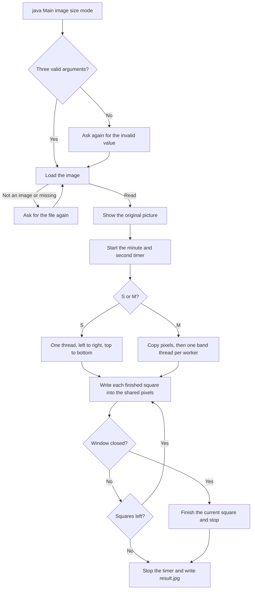

# PL-A4

This program opens an image, replaces every square of pixels with the average color of that square, and shows the change as each square is finished. The window can be smaller than the picture. The average is always calculated from the original pixels, and `result.jpg` is saved at the original width and height.

It runs on Windows and macOS with any JDK from Java 8 upward, including Java 17 and newer. The sources use only Java 8 language and libraries.

## What you will see

1. The original picture appears in a window before any square is changed.
2. A timer under the picture starts at `Time: 00:00` and counts minutes and seconds while squares are painted.
3. Each square turns into one flat color, then that worker pauses for a short time so the square can be seen. Single-thread pauses after every square, one after another. Multi-thread pauses inside each band at the same time, so several rows advance together and the picture finishes sooner.
4. When painting finishes, the timer stops on the final time. The status line and the console say `Saved` followed by the full path of `result.jpg`.
5. The same file is written in the working directory. Closing the window early stops further squares and saves the picture as it is at that moment.

## Setup

Install a JDK and make sure `java` and `javac` are on `PATH`. If no Java is installed at all, install any JDK 8 or newer first. The commands below are run from the project directory.

JDK 9 or newer, including 17 and 21, on Windows:

```text
javac --release 8 -d out src\Main.java src\Launch.java src\band\*.java src\cli\*.java src\exceptions\*.java src\image\*.java src\log\*.java src\process\*.java src\view\*.java src\window\*.java src\worker\*.java
java -cp out Main image.jpg 20 S
```

The same compile on macOS, then a multi-thread run:

```text
javac --release 8 -d out src/Main.java src/Launch.java src/band/*.java src/cli/*.java src/exceptions/*.java src/image/*.java src/log/*.java src/process/*.java src/view/*.java src/window/*.java src/worker/*.java
java -cp out Main image.jpg 20 M
```

JDK 8 has no `--release` flag. Replace `--release 8` with `-source 8 -target 8`. The `java -cp out Main ...` command stays the same.

`Launch` is an optional starter. It compiles every file under `src` for Java 8 with the JDK that is already installed, then starts `Main` and forwards the same three arguments:

```text
javac --release 8 -d out src/Launch.java src/log/Log.java
java -cp out Launch image.jpg 20 S
```

On JDK 8, compile `Launch` with `-source 8 -target 8`. `Launch` chooses `--release 8` when the running JDK is 9 or newer, and `-source 8 -target 8` on JDK 8.

IntelliJ can run `Main` directly. Give it the three program arguments, for example `img/img.png 20 M`. With no arguments, the console menu opens.

## Arguments

The program takes three arguments:

```text
java -cp out Main <image> <square size> <S|M>
```

| Argument | Meaning |
| --- | --- |
| Image | Path of a picture. JPEG, PNG, GIF, and BMP are accepted, and so is any other format the JDK can read. There is no limit on width or height. |
| Square size | Side length of each square, in pixels. It must be a positive whole number. |
| Mode | `S` uses one thread. `M` uses several threads. The letter is case-insensitive. |

Examples:

```text
java -cp out Main img/img.png 20 S
java -cp out Main C:\photos\holiday.jpg 5 M
java -cp out Main img/img_1.png 40 M
```

With a square size of 20, each 20 by 20 block becomes one flat color. When the width or height is not a multiple of the square size, the last block on the right or the bottom is smaller. That smaller block is averaged only over the pixels that exist. A 25 by 17 picture with square size 10 has a 5-pixel column on the right and a 7-pixel row on the bottom.

### When an answer is wrong

The program does not quit on a bad answer. It asks again for the value that failed and keeps the values that were already valid.

- A missing third argument prints the usage line and opens the menu.
- A square size of `0`, a negative number, or text asks for the size again.
- `Y`, or any letter other than `S` or `M`, prints `Enter S or M.` and asks for the mode again.
- A missing file, a directory, or a file that is not an image prints that error and asks for the file again. The square size and mode stay as they were.

If the file name is left out, the menu lists every file currently in `img/`. That folder is found next to the working directory, and also at `src/img` when the program is started from the project root, which is what IntelliJ does. The names are read from the folder each time, so adding or renaming a file changes the next list. You can type a number, the file name shown in the list, or the path of your own picture. `img.png` in that list is opened as `img/img.png`. `Q` quits.

```text
PL-A4
Each square of the image is replaced by its average color.

Images in img/:
1. img.png
2. img_1.png

Enter a number or a name from the list, or type the path of your own image.
Image, or Q to quit:
```

Console text is printed by `log.Log`. Questions use `Log.prompt`, so the cursor stays on the same line while you type. Other messages use `Log.line`.

## Flow



`Main` only opens `cli.Menu`. The menu reads the arguments, loads the image, shows the window, runs the processor, and writes the file.

The picture is shown, and the first paint is waited for, before any square is changed. Processing then runs on a background thread named `image-processor`, so the window can repaint. A finished square is written into a shared pixel buffer, and the worker then pauses. The pause is normally 40 milliseconds. When one band would otherwise pause for more than six seconds, the pause is shortened. About thirty times a second the Swing thread copies that buffer onto the image and redraws, so the pause is what makes the painting visible. When the walk finishes, one last copy is drawn before the timer stops.

## Single-thread mode

`S` selects `SingleThreadProcessor`. It copies the pixels once, then walks `ImageRegion.forImage` from left to right, then top to bottom, on one thread. For every square it computes the average and writes that color into the shared buffer. The window copies the buffer onto the image on its own timer.

One square is in progress at a time, followed by the pause. The order on screen is the same order as the walk.

## Multi-thread mode

`M` selects `MultiThreadProcessor`. It does the same left-to-right, top-to-bottom walk, split across horizontal bands that run together.

1. The full image is copied once into an `int` array. Later squares are averaged from that copy.
2. `WorkerCount` chooses the number of workers. That number is the number of CPU cores, and it is never larger than the number of square rows. One row of squares uses one worker. A picture with fewer square rows than cores uses one worker per row.
3. `RowBand.split` groups those rows into contiguous bands. The first `rows % workers` bands receive one extra row, so the bands differ by at most one row.
4. Each band runs on its own thread, named `image-band-0`, `image-band-1`, and so on. Inside a band the squares still go left to right, then top to bottom.
5. A finished square is written into the shared pixel buffer, and that band then pauses. The bands pause at the same time, so the wait does not stack the way it does in single-thread mode. The band threads never call `setRGB`. Only the Swing thread copies the buffer onto the image.

`BufferedImage` is not safe for several threads to read while another thread paints. The copied pixels keep the average equal to the single-thread result. A full run of `S` and `M` on the same picture produces the same colors.

## Average color

For each square, the red, green, and blue channels are summed separately over every pixel that exists in that square. Alpha is ignored while reading. The channel value is the arithmetic mean, rounded to the nearest whole number with half rounded up:

```text
(sum + count / 2) / count
```

The square is then filled with that opaque color. A 20 by 20 square uses 400 pixels. A partial edge square uses only its own width times height.

## Window, timer, and screen size

The window title is `PL-A4`. Under the picture there are two lines:

- `Time: 00:00`, which advances once per second
- `Mode: S    Square size: 20`, and after the save, `Saved` plus the full path of `result.jpg`

The timer starts when processing starts and stops when processing returns. Closing the window also ends processing, so the timer stops there too. The last time stays on the label.

The frame uses the largest area the screen can give it, after window borders and the lines under the picture. If the picture is larger than that area, the panel is made smaller and the picture is drawn into the panel with bilinear scaling. The width-to-height ratio stays the same. A picture that already fits is shown at its real size, with no scaling up.

That scale exists only while drawing. `ImagePanel` keeps the original `BufferedImage`. Squares are located and filled in that image. `result.jpg` is written from it, at the original width and height.

## Closing the window

The close button does not wait for every square. `CloseRequest` calls `stop` on the processor. The loop checks that flag before each square. The square already in progress is finished, so the file is not left half painted, and then the walk returns. `result.jpg` is the picture at that moment. If the close happens before processing starts, the saved file is the original picture.

## Output file

`ResultWriter` writes `result.jpg` in the working directory and reports that file's full path, for example `C:\Users\User\IdeaProjects\PL-A4\result.jpg` on Windows. The file name is fixed. If the loaded picture is not RGB, it is copied to an RGB image of the same size first, because a JPEG writer needs that form. The copy still has the original width and height.

## Packages

| Package | What lives there |
| --- | --- |
| `cli` | `Menu`, `Arguments`, and `Mode`. The menu reads arguments and drives one run. `Mode` maps `S` and `M` to the processor. |
| `image` | Loading, square bounds, the average color, the listener that receives a finished square, and writing `result.jpg`. |
| `process` | `ThreadProcessor` and the single-thread and multi-thread processors. |
| `band` | `RowBand`, one horizontal strip of squares. |
| `worker` | `WorkerCount`, how many band threads to start. |
| `view` | `ImageWindow`, `ImagePanel`, and `PaintPace`. The pace is the short pause after each square. |
| `window` | `CloseRequest` and `UiThread`, closing the frame and running updates on the Swing thread. |
| `log` | `Log`, the only class that writes to the console. |
| `exceptions` | The program's own errors. They extend `ApplicationException`. |

`Main` and `Launch` stay in the default package so the command is `java Main` or `java Launch`.

## Errors

A problem is reported with a specific exception, and the message is printed. The usual ones:

| Situation | Exception | Message |
| --- | --- | --- |
| Blank file name | `MissingFileNameException` | File name is missing. |
| Square size is not a positive integer | `InvalidSquareSizeException` | Square size must be a positive integer. |
| Mode is not `S` or `M` | `InvalidModeException` | Enter S or M. |
| Path does not exist | `ImageFileNotFoundException` | File not found: … |
| Path is not a file | `NotAFileException` | Not a file: … |
| JDK cannot read it as an image | `NotAnImageException` | Not an image: … |
| The image file cannot be decoded | `ImageReadException` | Cannot read image: … |
| `result.jpg` cannot be written | `ImageWriteException` | Cannot write image: result.jpg |

The window also uses `MissingImageException`, `MissingSummaryException`, and `WindowException`. Processing uses `ProcessingInterruptedException` if a worker is interrupted.

## Check

Both modes were run on a 25 by 17 JPEG with square size 10. That leaves a 5-pixel column on the right and a 7-pixel row on the bottom. Single-thread and multi-thread produced the same pixels, including those partial squares, and both matched the average of each square in the loaded image. The two saved `result.jpg` files matched as well.

The menu was also given a square size of `0`, the mode `Y`, and a missing file. Each of those answers was asked again, and the program stayed open. Typing the name `img.png` from the `img/` list opens `img/img.png`.
